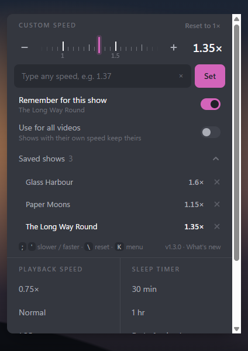
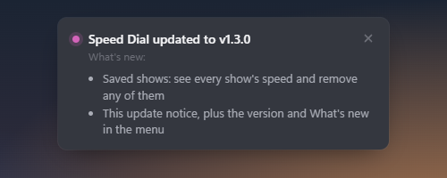
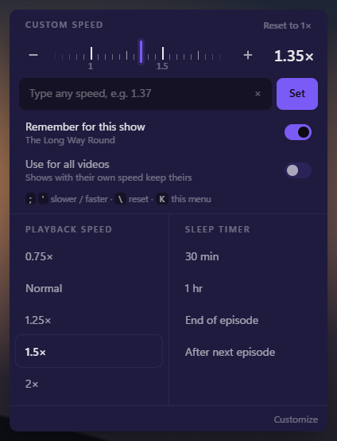
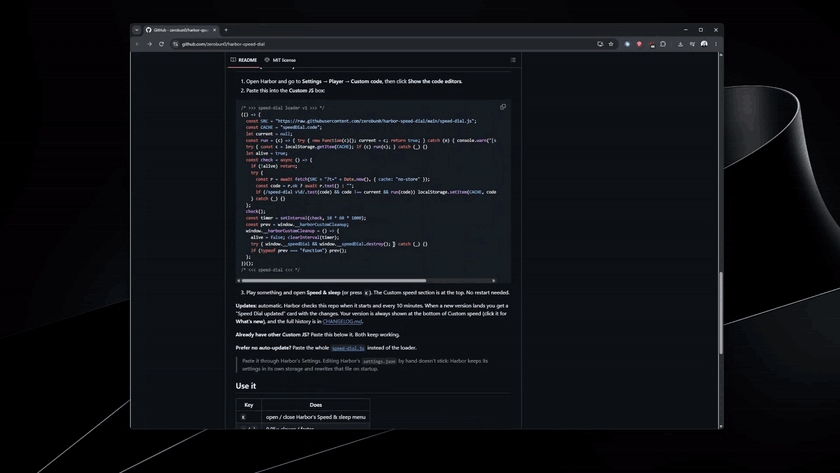

# Speed Dial for Harbor

Pick **any** playback speed in the [Harbor](https://github.com/Harborofficial/Harbor) player, not just the presets.
It adds a **Custom speed** section to Harbor's own **Speed & sleep** menu: drag a dial, type `1.37`, remember a speed per show.
No extra buttons, and it follows your Harbor theme.


## What it does

- **Any speed from 0.1× to 8×**: drag or scroll the dial (0.05 steps), use − / +, tap a preset, or type an exact number
- **Built into Harbor's Speed & sleep menu**: nothing extra on screen, Harbor's presets and sleep timer stay as they are
- **Remember for this show**: every episode of that show starts at your speed. Movies count on their own
- **Use for all videos**: one speed for everything else
- **Saved shows**: see every show's speed and remove any of them
- **Follows your theme**: colours, font and corners come from whatever Harbor theme you use, and change live
- **Stays in sync** with Harbor's own `[` `]` speed keys
- **Updates itself** from this repo, with a cached copy so it still works offline. A small card tells you when it updated and what's new

 

| Your theme | Nord | Violet |
| --- | --- | --- |
|  |  |  |

## Install (1 minute)

<p align="center"></p>
<p align="center"><sub>13 seconds, start to finish. <a href="docs/install.mp4">Full quality video</a></sub></p>

1. Open Harbor and go to **Settings → System → Custom code**, then click **Show the code editors**.
   (Older Harbor versions have it under **Settings → Advanced → Custom code**. Can't find it? Type `Custom JS` in the Settings search.)
2. Paste this into the **Custom JS** box:

```js
/* >>> speed-dial loader v1 >>> */
(() => {
  const SRC = "https://raw.githubusercontent.com/zerobun0/harbor-speed-dial/main/speed-dial.js";
  const CACHE = "speedDial.code";
  let current = null;
  const run = (c) => { try { new Function(c)(); current = c; return true; } catch (e) { console.warn("[speed-dial]", e); return false; } };
  try { const c = localStorage.getItem(CACHE); if (c) run(c); } catch (_) {}
  let alive = true;
  const check = async () => {
    if (!alive) return;
    try {
      const r = await fetch(SRC + "?t=" + Date.now(), { cache: "no-store" });
      const code = r.ok ? await r.text() : "";
      if (/speed-dial v\d/.test(code) && code !== current && run(code)) localStorage.setItem(CACHE, code);
    } catch (_) {}
  };
  check();
  const timer = setInterval(check, 10 * 60 * 1000);
  const prev = window.__harborCustomCleanup;
  window.__harborCustomCleanup = () => {
    alive = false; clearInterval(timer);
    try { window.__speedDial && window.__speedDial.destroy(); } catch (_) {}
    if (typeof prev === "function") prev();
  };
})();
/* <<< speed-dial <<< */
```

3. Play something and open **Speed & sleep** (or press `K`). The Custom speed section is at the top. No restart needed.

**Updates:** automatic. Speed Dial checks this repo a few seconds after Harbor starts and then every 3 minutes, so a new version usually reaches you within minutes. When a new version lands you get a
"Speed Dial updated" card with the changes. Your version is always shown at the bottom of Custom speed (click it for
**What's new**), and the full history is in [CHANGELOG.md](CHANGELOG.md).

**Already have other Custom JS?** Paste this below it. Both keep working.

**Prefer no auto-update?** Paste the whole [`speed-dial.js`](speed-dial.js) instead of the loader.

> Paste it through Harbor's Settings. Editing Harbor's `settings.json` by hand doesn't stick:
> Harbor keeps its settings in its own storage and rewrites that file on startup.

## Use it

| Key | Does |
| --- | --- |
| `K` | open / close Harbor's Speed & sleep menu |
| `;` / `'` | 0.05× slower / faster |
| `\` | back to 1× |
| `[` / `]` | Harbor's own 0.25× steps (unchanged) |

You can also scroll on the dial to change speed.

**Priority when a new video starts:** the show's own speed, then "Use for all videos", then Harbor's default speed.
Harbor's default is the speed you pinned in Harbor's own list ("Set as default speed"). If every new show starts at the same unusual speed, check that pin.

## Remove

Delete everything from `/* >>> speed-dial` to `/* <<< speed-dial <<< */` in **Custom JS** (Settings → System → Custom code), or press **Clear** if it's the only
thing there. It cleans up right away.

## Tweak it

The top of [`speed-dial.js`](speed-dial.js) has the presets, dial range, step size and keys. Fork the repo,
change them, and point `SRC` in the loader at your fork.

## Notes

- Works with Harbor v1.0.3 and later (Harborofficial/Harbor), on the built-in mpv player and the HTML5 player.
- If you've hidden Harbor's speed button in the player layout editor, `K` opens Custom speed as a menu of its own.
- Saved speeds live in Harbor's local storage on your PC. Nothing is sent anywhere. The only network request is fetching updates from this repo.
- Not affiliated with the Harbor team.

## Licence

MIT
