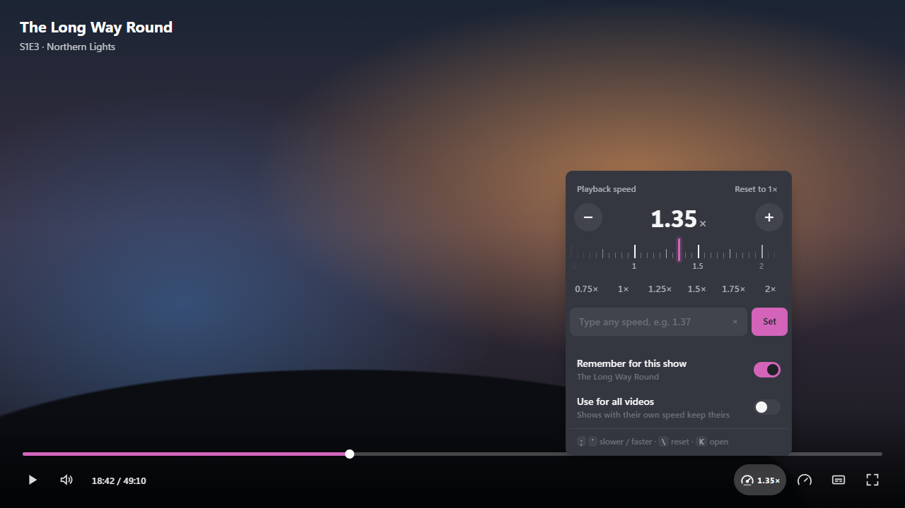
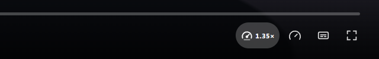
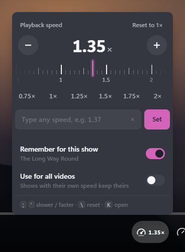
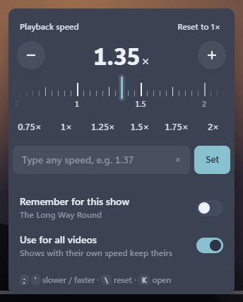

# Speed Dial for Harbor

Pick **any** playback speed in the [Harbor](https://github.com/Harborofficial/Harbor) player, not just the presets.
Drag a dial, type `1.37`, or tap a preset. Remember a speed per show. It follows your Harbor theme.



## What it does

- **Any speed from 0.1× to 8×**: drag or scroll the dial (0.05 steps), use − / +, tap a preset, or type an exact number
- **Lives in Harbor's control bar**, next to the built-in speed button, and looks like it belongs there
- **Remember for this show**: every episode of that show starts at your speed. Movies count on their own
- **Use for all videos**: one speed for everything else
- **Follows your theme**: colours, font and corners come from whatever Harbor theme you use, and change live
- **Stays in sync** with Harbor's own `[` `]` speed keys
- **Updates itself** from this repo, with a cached copy so it still works offline



| Your theme | Nord | Violet |
| --- | --- | --- |
|  |  |  |

## Install (1 minute)

1. Open Harbor and go to **Settings → Player → Custom code**, then click **Show the code editors**.
2. Paste this into the **Custom JS** box:

```js
/* >>> speed-dial loader v1 >>> */
(() => {
  const SRC = "https://raw.githubusercontent.com/zerobun0/harbor-speed-dial/main/speed-dial.js";
  const CACHE = "speedDial.code";
  let current = null;
  const run = (c) => { try { new Function(c)(); current = c; return true; } catch (e) { console.warn("[speed-dial]", e); return false; } };
  try { const c = localStorage.getItem(CACHE); if (c) run(c); } catch (_) {}
  let alive = true;
  const check = async () => {
    if (!alive) return;
    try {
      const r = await fetch(SRC + "?t=" + Date.now(), { cache: "no-store" });
      const code = r.ok ? await r.text() : "";
      if (/speed-dial v\d/.test(code) && code !== current && run(code)) localStorage.setItem(CACHE, code);
    } catch (_) {}
  };
  check();
  const timer = setInterval(check, 10 * 60 * 1000);
  const prev = window.__harborCustomCleanup;
  window.__harborCustomCleanup = () => {
    alive = false; clearInterval(timer);
    try { window.__speedDial && window.__speedDial.destroy(); } catch (_) {}
    if (typeof prev === "function") prev();
  };
})();
/* <<< speed-dial <<< */
```

3. Play something. The new dial button is in the control bar. No restart needed.

**Updates:** automatic. Harbor checks this repo when it starts and every 10 minutes.

**Already have other Custom JS?** Paste this below it. Both keep working.

**Prefer no auto-update?** Paste the whole [`speed-dial.js`](speed-dial.js) instead of the loader.

### Install with PowerShell (Windows)

Download this repo, then in its folder:

```powershell
.\speed-dial.ps1 install -CloseHarbor   # closes Harbor, installs, reopens it
.\speed-dial.ps1 status                 # what's installed
.\speed-dial.ps1 remove -CloseHarbor    # take it out again
```

Add `-Offline` to install the full script with no auto-update. The script only changes the Custom JS setting,
keeps any other code you have there, and saves a backup of Harbor's settings first.

## Use it

| Key | Does |
| --- | --- |
| `K` | open / close the panel |
| `;` / `'` | 0.05× slower / faster |
| `\` | back to 1× |
| `[` / `]` | Harbor's own 0.25× steps (unchanged) |

You can also scroll on the dial button to change speed without opening the panel.

**Priority when a new video starts:** the show's own speed, then "Use for all videos", then Harbor's default speed.

## Remove

Delete everything from `/* >>> speed-dial` to `/* <<< speed-dial <<< */` in **Custom JS** (or run `.\speed-dial.ps1 remove`).
It cleans up right away.

## Tweak it

The top of [`speed-dial.js`](speed-dial.js) has the presets, dial range, step size and keys. Fork the repo,
change them, and point `SRC` in the loader at your fork.

## Notes

- Works with Harbor v1.0.3 and later (Harborofficial/Harbor), on the built-in mpv player and the HTML5 player.
- If you've hidden Harbor's speed button in the player layout editor, the dial button floats at the bottom right instead.
- Saved speeds live in Harbor's local storage on your PC. Nothing is sent anywhere. The only network request is fetching updates from this repo.
- Not affiliated with the Harbor team.

## Licence

MIT
